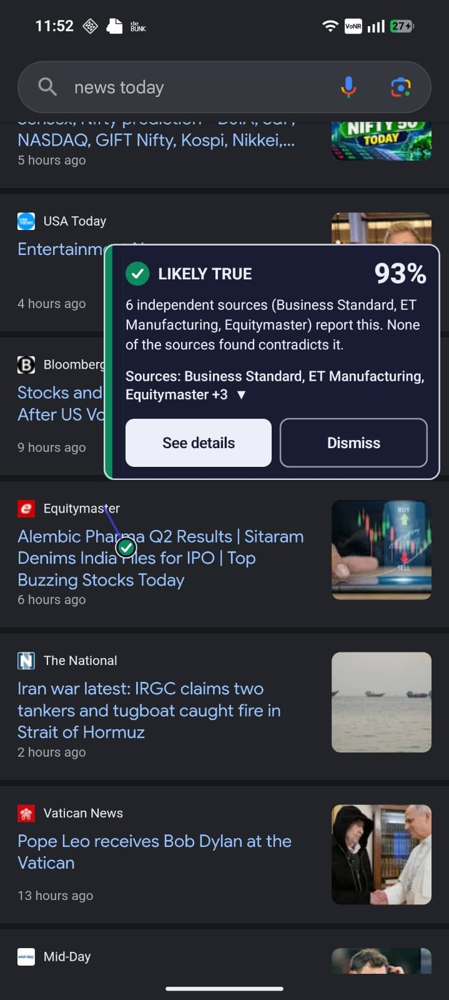
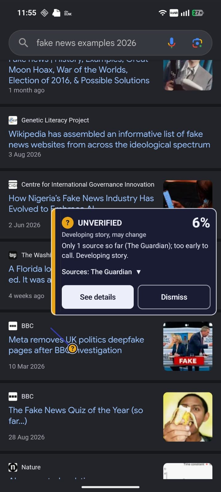
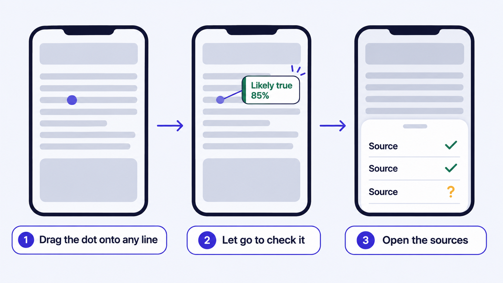
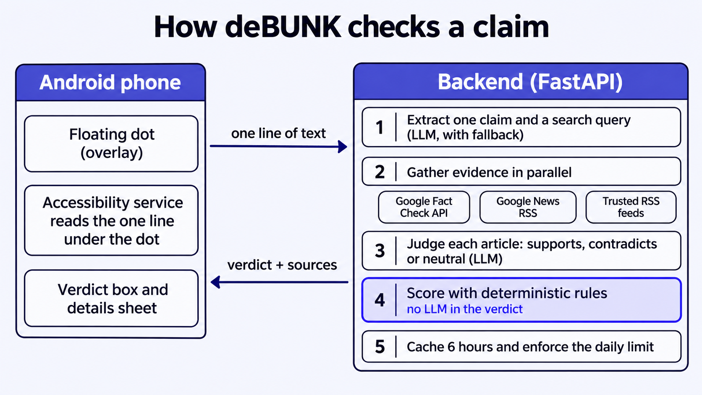
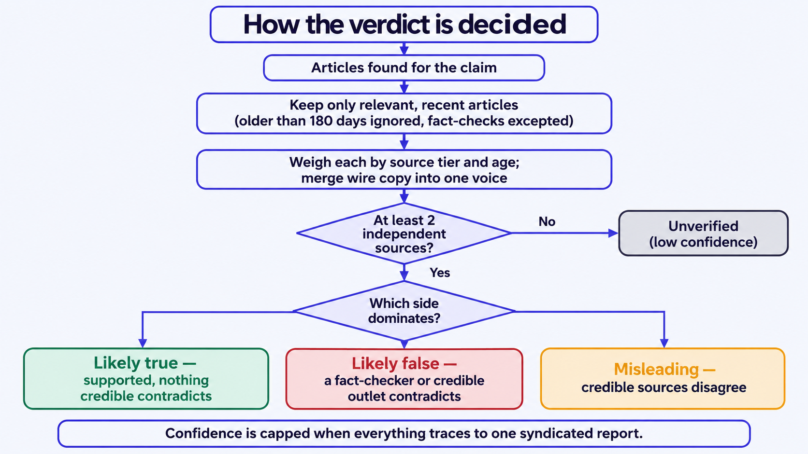
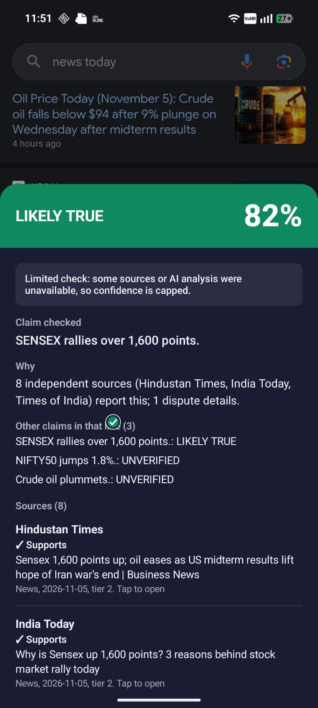
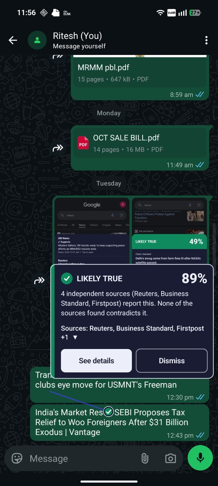
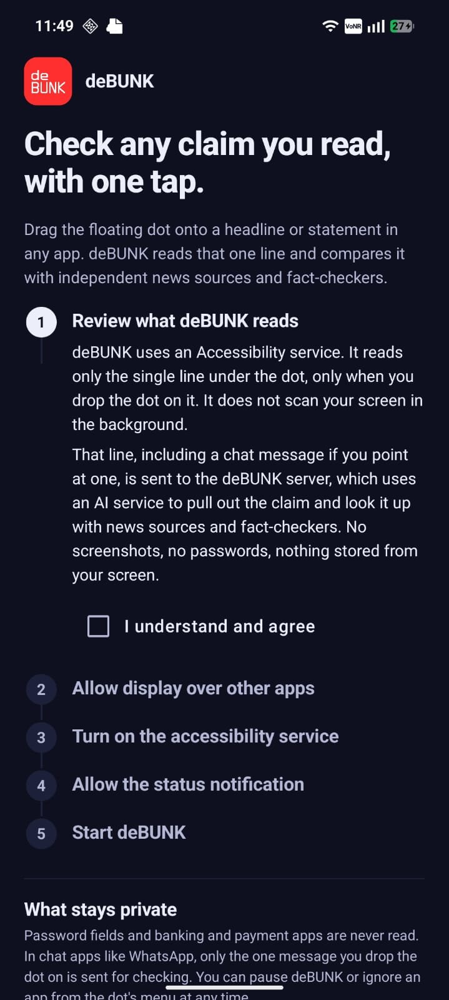

# deBUNK

**Fact-check any claim on your phone screen with one drag.**
A small dot floats over every app. Drop it on a headline, a post or a chat message, and deBUNK shows a verdict, a
confidence score and the sources behind it, without leaving the app you're reading.

<p align="center">
  
  
  
</p>

## What it does

- **Point, don't paste.** Drag the dot onto any line of text in any app, including chat apps. Only that one line is read.
- **Verdict you can audit.** Likely true, likely false, misleading or unverified, with a confidence percentage and every
  source listed with its stance (supports, contradicts, doesn't settle) and a link to open it.
- **Honest about uncertainty.** With fewer than two independent sources it says "unverified" instead of guessing, and
  missing coverage is never treated as proof that something is false.
- **Private by design.** No background scanning, no screenshots, no passwords. Banking, payment and keyboard apps are never read.

<p align="center">
  
</p>

## How it works

<p align="center">
  
</p>

### The verdict is rule-based, not model-based

The LLM only extracts the claim and labels each article. The verdict itself comes from tested rules in
[`backend/app/verdict.py`](backend/app/verdict.py), so it is explainable and repeatable:

<p align="center">
  
</p>


| Rule | Why |
|---|---|
| Sources are weighted by credibility tier (fact-checkers and wires > major outlets > others) | Not all outlets are equal evidence |
| Newer articles count more; anything older than 180 days is ignored (fact-checks excepted) | Last year's story doesn't confirm today's claim |
| One voice per outlet, and near-identical headlines across outlets collapse into one voice | Wire copy repeated by ten sites is one report, not ten |
| At least two independent sources are needed, otherwise the result is "unverified" | No verdict on thin evidence |
| "Likely false" needs a contradicting fact-checker or credible outlet | Absence of coverage is not falsity |
| Mixed credible evidence gives "misleading"; irrelevant neutral coverage dilutes confidence | Disagreement should show |
| Confidence is capped when everything traces to one syndicated report | Don't overstate |

### Built to keep working when things fail

- Every LLM call has a time budget and a non-LLM fallback. Models are tried in order, rate-limited ones are skipped for a
  cooldown, and a backup provider can take over.
- If sources can't be reached, the app says so. It never shows a fake "0% unverified".
- Untrusted text is delimited and never treated as instructions (prompt-injection defence).
- Server logs hold a hash of the text, not the text.

## Screenshots

| Details sheet | Chat apps | Setup |
|:---:|:---:|:---:|
|  |  |  |
| Every source with its stance, and a link to open it | Only the one message you point at is read | Plain-language consent before any permission is requested |

## Tech stack

| Part | Technology |
|---|---|
| Android app | Kotlin, Jetpack Compose, Material 3, AccessibilityService, overlay windows, foreground service, coroutines |
| Shared logic | Pure Kotlin/JVM module (scan coordinator, app policy, throttling, overlay geometry) with JUnit tests |
| Backend | Python, FastAPI, httpx, pydantic, SQLite, pytest |
| LLM | Any OpenAI-compatible API (Groq, Gemini, OpenRouter, Ollama) or Anthropic; default `gpt-oss-20b` on Groq |
| Evidence | Google Fact Check Tools API, Google News RSS search, RSS feeds of established outlets |
| Deploy | Docker, `render.yaml` for Render |

## Project structure

```
app/        Android app: accessibility reader, overlay UI, details sheet, setup screens
core/       Platform-free Kotlin logic, unit-tested without a device
backend/
  app/
    main.py          API endpoints, request flow, quota
    claims.py        claim extraction (LLM + heuristic)
    llm.py           provider-agnostic LLM client, model chain, cooldowns
    providers/       Fact Check, Google News RSS, RSS feeds
    scoring.py       per-article stance labelling
    verdict.py       deterministic verdict rules
    tiers.py         source credibility tiers
    prompts/         the two prompts, as editable files
  tests/             verdict rules, API behaviour, providers
docs/        development notes and screenshots
```

## Getting started

### Backend

```bash
cd backend
python -m venv .venv && source .venv/bin/activate     # Windows: .venv\Scripts\activate
pip install -r requirements.txt
cp .env.example .env                                   # add your keys (see the comments inside)
uvicorn app.main:app --host 0.0.0.0 --port 8000
pytest                                                 # needs no network or keys
```

Only an LLM key is required. Without any key the backend still runs with heuristic extraction and stance (weaker, and
marked "degraded"). Free options: [Groq](https://console.groq.com/keys) and [Google AI Studio](https://aistudio.google.com/apikey).
Check a provider's terms before using a free tier in a published product.

Try it:

```bash
curl -X POST http://localhost:8000/v1/verify \
  -H "X-API-Key: $BACKEND_API_KEY" -H "X-Device-Id: $(printf 'a%.0s' {1..32})" \
  -H "Content-Type: application/json" \
  -d '{"text": "Federal Reserve cuts interest rates"}'
```

`POST /v1/debug` takes the same body and shows which sources answered and how each article was judged, which is the
fastest way to tune prompts and sources. Other endpoints: `GET /healthz`, `GET /v1/quota`.

### Android app

1. Copy `local.properties.example` to `local.properties` and set `debunk.backendUrl` and `debunk.backendKey`.
   Leave the URL empty to run offline with simulated verdicts.
2. Open the project in Android Studio and run it on a device (Android 10 or newer).
3. Follow the setup screen: read the disclosure, allow display over other apps, turn on the accessibility service,
   allow notifications, then start. Drag the dot onto a line and let go.

### Deploy

The backend ships with a `Dockerfile` and a `render.yaml` blueprint, including a small disk for the daily-limit counters.
Set the keys in the host's settings, never in the repo.

## Free plan limit

The server allows 10 checks per device per day (`FREE_DAILY_LIMIT`). The device is identified by a salted hash of
`ANDROID_ID`, so reinstalling the app doesn't reset it, and the raw id never leaves the phone. Premium devices are
unlimited. The upgrade button is a placeholder until Google Play Billing is connected.

## Evaluation

Not done yet, and I'd rather say so than quote numbers I haven't measured. The plan is a labelled set of about 100 claims
(true, false, misleading, too new to tell) scored on accuracy, how often a true claim is called false, latency and cost per
check, comparing the heuristic fallback against different models and prompt versions.

| Setup | Accuracy | Wrongly "false" | Median latency | Cost / 1,000 checks |
|---|---|---|---|---|
| Heuristic only | not measured | | | |
| `gpt-oss-20b` | not measured | | | |
| `gpt-oss-120b` | not measured | | | |

## Limitations

- Verdicts reflect news coverage and fact-checks, so brand-new or very local stories often stay "unverified".
- The model judges from headlines and snippets, not full articles, so it can miss nuance.
- Best support is for English and Hindi. The trusted-source lists lean towards India, the US and the UK.
- Whether a chat app exposes message text depends on the app; some screens can't be read.
- A fact-check tool is an aid, not an authority: read the sources before you share.

## Roadmap

- Evaluation set and results table
- More languages and regional source lists
- Google Play Billing for the premium plan
- Reading text from images (forwarded screenshots)

More background, including the original phase notes, is in [`docs/DEVELOPMENT_NOTES.md`](docs/DEVELOPMENT_NOTES.md).
